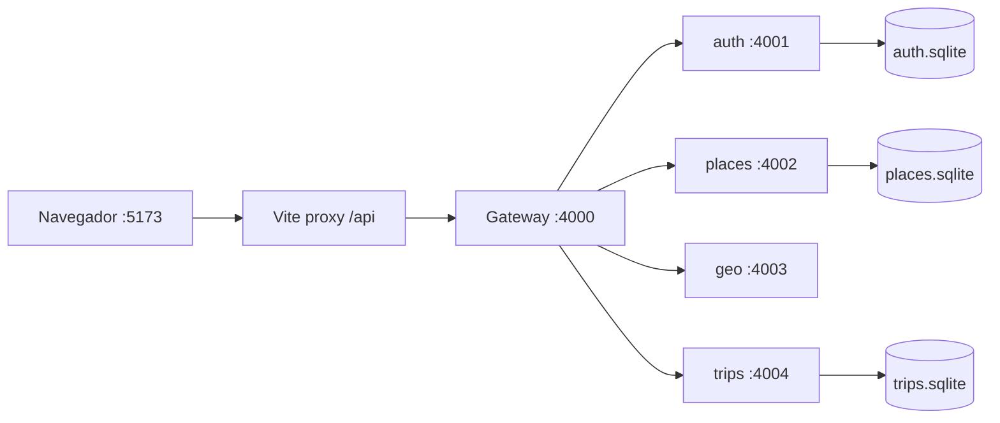

# WayTurismo — Estructura del proyecto

Guía detallada de carpetas y rutas. Resumen de frontend, backend, BD y microservicios en [README.md](./README.md#arquitectura-del-proyecto).

## Frontend

SPA en **React + Vite + Leaflet**. Carpeta `src/` (`main.jsx`, `App.jsx`), assets en `public/`. Puerto **5173**.

## Backend

**Node.js + Express** en `services/` (gateway + microservicios). Puerto publico **4000**. Legacy: `server/`.

## Base de datos

**SQLite** en `services/data/auth|places|trips/service.sqlite`. Helper: `services/shared/db.js`.

## Microservicios

- **gateway** – Entrada API (4000)
- **auth-service** – Usuarios (4001) + SQLite auth
- **places-service** – Lugares y areas (4002) + SQLite places
- **geo-service** – Mapas y georef (4003)
- **trips-service** – Favoritos y rutas (4004) + SQLite trips

## Árbol de carpetas

```
proyecto-wayturismo/
├── src/                          # FRONTEND (React + Vite)
│   ├── main.jsx                  # Punto de entrada
│   ├── App.jsx                   # UI principal (mapa, auth, favoritos, rutas, admin)
│   ├── App.css / index.css       # Estilos
│   └── (sin subcarpetas components/ — todo en App.jsx)
│
├── public/                       # Assets estáticos del frontend
│   ├── wayturismo-logo.png
│   └── icons/                    # Iconos por categoría (bodegas, hoteles, etc.)
│
├── index.html                    # HTML base de Vite
├── vite.config.js                # Dev server + proxy /api → gateway :4000
│
├── services/                     # BACKEND (microservicios)
│   ├── gateway/
│   │   └── index.js              # API Gateway (puerto 4000) — proxy y /api/health
│   ├── auth-service/
│   │   └── index.js              # Registro, login, usuarios (puerto 4001)
│   ├── places-service/
│   │   └── index.js              # Lugares, áreas, búsqueda rápida, ABM admin (4002)
│   ├── geo-service/
│   │   └── index.js              # GeoJSON, calles, geocoding, provincias/deptos (4003)
│   ├── trips-service/
│   │   └── index.js              # Favoritos y rutas guardadas (4004)
│   ├── shared/                   # Código compartido entre microservicios
│   │   ├── db.js                 # Conexión SQLite por servicio
│   │   ├── jwt.js                # JWT + middleware auth/admin
│   │   └── http.js               # Factory Express (cors, json)
│   └── data/                     # BASE DE DATOS (SQLite por servicio)
│       ├── auth/service.sqlite   # Tabla: users
│       ├── places/service.sqlite # Tablas: areas, places
│       └── trips/service.sqlite  # Tablas: favorites, routes
│
├── server/                       # BACKEND LEGACY (monolito, solo pruebas)
│   ├── index.js                  # API monolítica con todas las rutas /api/*
│   ├── db.js                     # SQLite única: server/data/wayturismo.sqlite
│   ├── seedData.js               # Datos iniciales (áreas y lugares)
│   ├── famousPlaces.js           # Lugares famosos (seed)
│   ├── mendozaPlaces.js
│   ├── argentinaPlaces.js
│   ├── geoFilter.js              # Filtro Antártida en GeoJSON
│   ├── geoNormalize.js           # Filtros por provincia/departamento
│   └── data/
│       └── wayturismo.sqlite     # BD monolito (legacy / migración a auth)
│
├── scripts/
│   └── setup.mjs                 # Crea .env y carpetas de datos
│
├── .github/workflows/ci.yml      # CI (lint + build)
├── docker-compose.yml            # Orquestación de los 5 contenedores
├── Dockerfile
├── render.yaml / railway.json    # Deploy cloud
└── wayturismo.code-workspace     # Workspace VS Code
```

## Dónde está cada componente

| Componente | Ubicación | Puerto (dev) | Notas |
|------------|-----------|--------------|--------|
| **Frontend** | `src/`, `public/`, `index.html` | `5173` (Vite) | `npm run dev:client` |
| **API Gateway** | `services/gateway/index.js` | `4000` | Reenvía a los 4 servicios |
| **Auth** | `services/auth-service/index.js` | `4001` | `/api/auth/*` vía gateway |
| **Places** | `services/places-service/index.js` | `4002` | Lugares, áreas, admin |
| **Geo** | `services/geo-service/index.js` | `4003` | Mapas, calles, georef |
| **Trips** | `services/trips-service/index.js` | `4004` | Favoritos y rutas |
| **Monolito (legacy)** | `server/index.js` | `4000` | `npm run dev:monolith` |
| **Base de datos** | `services/data/{auth,places,trips}/` | — | Un `.sqlite` por servicio |
| **BD monolito** | `server/data/wayturismo.sqlite` | — | Solo si usas `server/` |
| **Middleware JWT** | `services/shared/jwt.js` | — | `authMiddleware`, `adminMiddleware` |
| **Acceso a BD** | `services/shared/db.js` | — | `createDatabase('auth' \| 'places' \| 'trips')` |
| **Datos seed** | `server/seedData.js`, `*Places.js` | — | Importados por `places-service` |

## Rutas / controladores

No hay carpetas `controllers/` ni `routes/`. Cada endpoint se define con `app.get` / `app.post` en el `index.js` del servicio.

| Ruta pública (gateway) | Servicio | Archivo |
|------------------------|----------|---------|
| `GET /api/health` | Gateway | `services/gateway/index.js` |
| `POST /api/auth/register`, `login` | Auth | `services/auth-service/index.js` |
| `GET /api/places`, `/places/by-ids` | Places | `services/places-service/index.js` |
| `GET /api/areas`, `/quick-search` | Places | `services/places-service/index.js` |
| `POST/PUT/DELETE /api/admin/places` | Places | `services/places-service/index.js` |
| `GET /api/geo/*`, `/geocode`, `/locations/*` | Geo | `services/geo-service/index.js` |
| `GET/POST /api/favorites`, `/routes` | Trips | `services/trips-service/index.js` |

En el monolito, las mismas rutas están bajo `/api/` en `server/index.js`.

## Flujo de una petición



Tests, infraestructura, comandos y guía de instalación: [README.md](./README.md).
